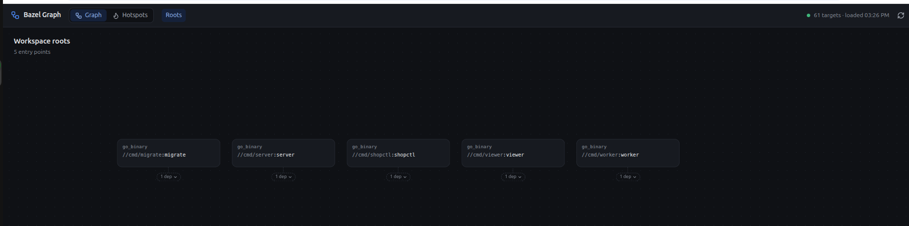
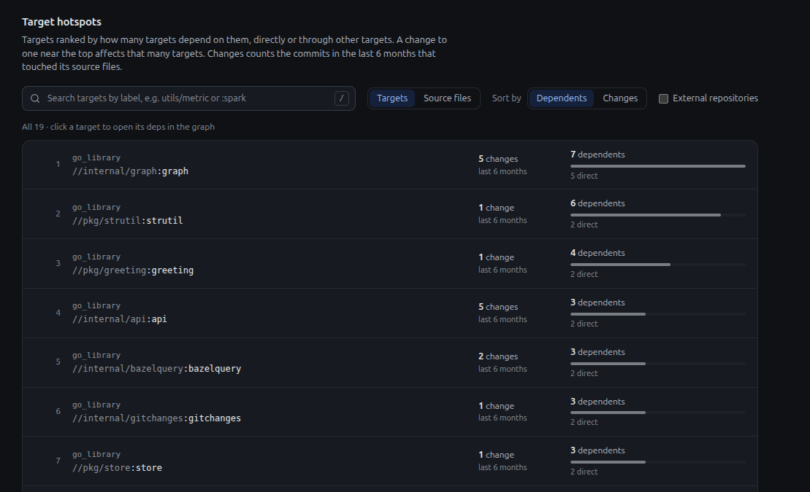

# Bazel Graph Viewer

Explore a Bazel workspace's dependency graph in the browser, and find its
hotspots: the targets and files that much of the build depends on, and how
often they change.

- **Graph.** Start at the workspace's entry points and drill down one layer at a
  time: click a target to see its direct deps, with a breadcrumb back. The
  canvas pans and zooms, and stays fast on graphs with tens of thousands of
  targets because it only ever draws one layer.
- **Hotspots.** Every target, or every source file, ranked by how many targets
  depend on it directly or transitively: what a change to it affects. Each row
  also shows how many commits changed it in the last 6 months. Sort by
  dependents or by changes, search by label, and click a target to open it in
  the graph.





## Run it

You need [Bazelisk](https://github.com/bazelbuild/bazelisk) (installed as
`bazel` or `bazelisk`) and git. Bazel fetches Node.js and the frontend's npm
packages itself and builds the frontend into the viewer binary.

```bash
# Point the viewer at any Bazel workspace.
bazel run //cmd/viewer -- -workspace /path/to/your/workspace
```

Then open <http://127.0.0.1:8090>. The graph loads in the background; the
status in the top bar shows when it is ready. After you edit BUILD files, press
the reload button to load it again; the old graph stays on screen until the new
one is ready.

Without `-workspace`, the viewer inspects the directory you ran `bazel run`
from, so `bazel run //cmd/viewer` alone shows this repository, which includes an
example to explore under `example/`: a small online shop. It has four binaries
(`example/cmd/server`, `worker`, `shopctl` and `migrate`), services in
`example/internal/` (`orders`, `catalog`, `payments`, `inventory`, `db` and
more) and shared libraries in `example/pkg/`. The shop really runs:

```bash
bazel run //example/cmd/server           # shop API on :8080
curl 'localhost:8080/products?q=mug'
```

### Flags

| Flag | Default | |
| --- | --- | --- |
| `-workspace` | the directory `bazel run` was started from | Bazel workspace to inspect |
| `-addr` | `127.0.0.1:8090` | Address to listen on. Local only by default; there is no authentication. |
| `-bazel` | `bazelisk` if it is on `PATH`, else `bazel` | Bazel binary to run the query with |

## How it works

On each load the viewer runs two commands in the inspected workspace, in
parallel:

1. **`bazel query '//...:*' --output=streamed_jsonproto`**: every target in the
   main repository, with each rule's direct inputs. This does not load external
   repositories, so it never downloads toolchains (unlike `deps(//...)`, which
   fetches every one they register, such as a Python interpreter per platform).
   External targets your targets depend on appear as leaves: their labels, with
   no rule kind and no deps of their own.
2. **`git log --since="6 months ago" --name-only`**: one call for the whole
   history window, not one per file. A file's change count is the number of
   commits that touched it; a target's is the number of distinct commits that
   touched any of its own source files. Merge commits are not counted. If git
   fails, the graph still loads and the counts show as unknown.

The graph is kept in memory as a compact index. Hotspot rankings are computed
on the first request, walking every target's reverse dependencies on all CPUs:
about 25 ms for 28,000 targets and 16,000 files.

The viewer runs `bazelisk` by default because `bazel run` puts the viewer's own
Bazel version first on `PATH`. Calling that `bazel` would query your workspace
with the wrong version, and restart your workspace's Bazel server. Bazelisk reads
your workspace's `.bazelversion` instead.

### Limitations

- Change counts follow paths, so a file renamed within the window only counts
  the commits since its rename.
- A BUILD file is a source file that no rule lists as an input, so BUILD files
  show changes but no dependents.
- You can see what a target depends on, but not yet what depends on it.

## HTTP API

The frontend uses a small JSON API, which you can also call directly.

| Endpoint | |
| --- | --- |
| `GET /api/status` | `state` (`loading`, `ready` or `error`), target count, load time, `warning`, `error` |
| `POST /api/refresh` | Reload the graph in the background |
| `GET /api/roots` | The workspace's entry points |
| `GET /api/children?label=//pkg:target` | A target's direct deps; 404 for an unknown label |
| `GET /api/hotspots?of=targets\|files&sort=dependents\|changes&q=…` | Ranked targets or source files |

List endpoints take `offset` and `limit` (default 50, at most 1000) and return
`total`. `external=true` includes `@external` targets; `tests=true` adds test
targets to the roots. On hotspots, `q` keeps labels that contain it, ignoring
case, and each result keeps its `rank` in the full ranking. Until the first load
finishes, data endpoints return 503.

```bash
curl 'http://127.0.0.1:8090/api/hotspots?of=files&sort=changes&q=proto&limit=5'
```

## Develop

```bash
bazel test //...                         # Go tests and the frontend type check
pnpm --dir web install                   # once, for the dev server
pnpm --dir web dev                       # frontend on http://127.0.0.1:5173
```

The Vite dev server reloads the page as you edit `web/src` and forwards `/api`
to a viewer running on port 8090. `bazel run //cmd/viewer` rebuilds the
frontend from `web/src` itself, so the binary always has the current version.

The frontend's dependencies are locked in `web/pnpm-lock.yaml`, which Bazel
reads through rules_js. Add or upgrade packages with `pnpm --dir web add` so the
lockfile stays in step with `web/package.json`.

| Path | |
| --- | --- |
| `cmd/viewer` | The viewer binary: flags, loading, HTTP server |
| `internal/bazelquery` | Runs `bazel query` and parses its output |
| `internal/gitchanges` | Reads recent changes from `git log` |
| `internal/graph` | The in-memory graph, roots, deps and hotspot rankings |
| `internal/api` | HTTP handlers and background reloads |
| `web` | React frontend (React Flow canvas, Vite build) |
| `example` | The example shop to try the viewer on; nothing outside it imports it |

[`PRODUCT.md`](PRODUCT.md) describes what the viewer is for and its scope;
[`DESIGN.md`](DESIGN.md) is its visual design system.
